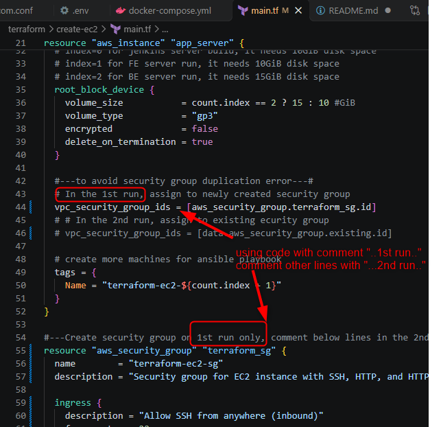

# Proj_ToDoList: MERN
Project To-Do-List

## Network Connections

Docker Compose publishes each service using `HOST_PORT:CONTAINER_PORT`. The first port is used from the host machine; containers communicate with one another over the Compose network.

```
flowchart LR
	Browser[Browser] -->|localhost:3001| Frontend[Frontend container :80] 
// Compose forwards host port `3001` to the frontend container's Nginx port 80

	Browser -->|localhost:8000/api| Backend[Backend container :8001]
// Axios uses this base URL. Compose forwards host port `8000` to backend port `8001`, where ExpressJS listens

	Backend -->|mongodb:27017| Mongo[MongoDB container :27017]
// The backend uses the Compose service name `mongodb` and MongoDB's container port `27017`

	HostTool[Host database tool] -->|localhost:27017| Mongo
// Compose publishes MongoDB port `27017` for tools running on the host, such as MongoDB Compass
```

The frontend Axios requests run in the browser and use the host-published backend address `localhost:8000`.

The API routes are mounted under `/api`: `/api/user`, `/api/task`, and `/api/forgotPassword`.


1- server run
t3.small
install docker, nginx
Only need docker compose & .env file

2- server build
t3.medium
install docker, nginx, Jenkins
add nginx domain for backend, frontend (cloudflare map in 2 server run), Jenkins (cloudflare map 1 server build)
pull all the sources from github

example from teacher:
	go-be: built in github, move img to server run (docker save|load)
	js-next-fe: built in github, push img to dockerhub, 

	server build is used to push img to dockerhub
..and we have to pull img from dockerhub to server run <- require login

CICD workflow in github action

## Terrform scripts usage
In "terraform\create-ec2\main.tf", there are 2 separate scripts used for 1st run and 2nd run onwards when creating AWS EC2 machines

# 1st run
Find comments with "...1st run..." and use those lines
Line #44, Line #55->#88
Comment-out codes with "...2nd run..."



# 2nd run onwards
Find comments with "...2nd run..." and use those lines
Line #17->#19, Line #46
Comment-out codes with "...1st run..."